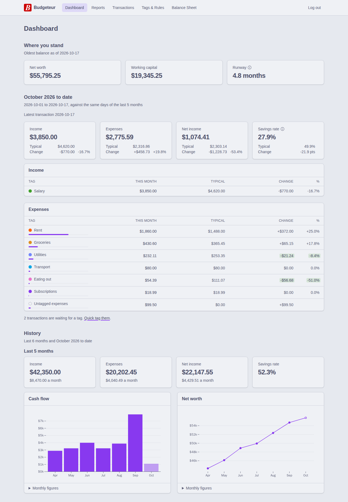
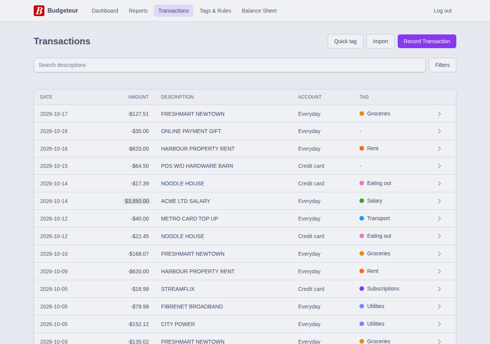
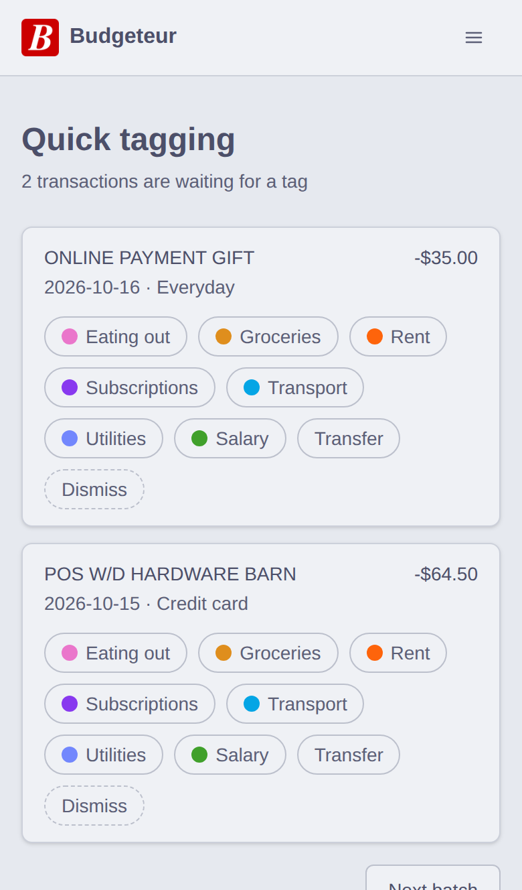
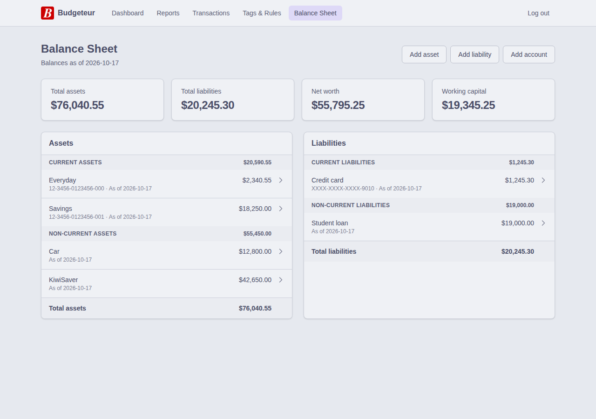
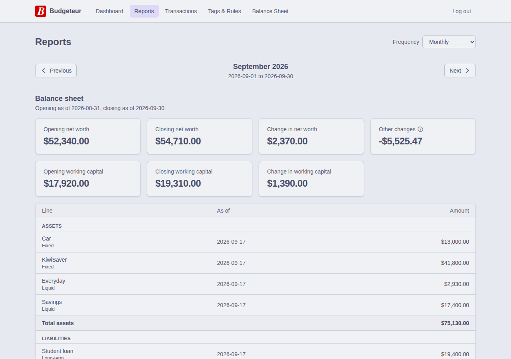
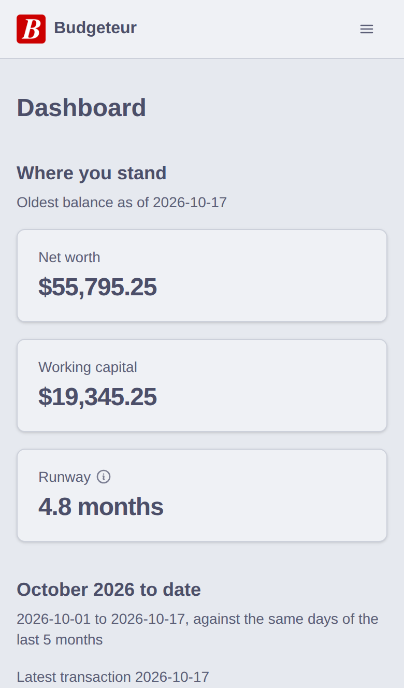

[](https://github.com/AnthonyDickson/budgeteur-fs/actions/workflows/ci.yml)
[](https://github.com/AnthonyDickson/budgeteur-fs/actions/workflows/e2e.yml)

# Budgeteur

## About

Budgeteur is a budgeting and personal finance web-app.

This app aims to provide two services:

- Budgeting: Recording your income and expenses, and tracking savings targets.
- Personal Finance: Keeping track of your net worth.

This application is intended to be self-hosted on a home server.



## Why?

I started budgeting with a mobile app, but I quickly ran into three main issues:

1. it required me to enter my income/expenses manually,
1. it only worked on my phone,
1. and it didn't help me with tracking my net worth.

I have tried using a spreadsheet to track my net worth, however I then ran into
issues where editing this spreadsheet from multiple devices lead to old copies
overwriting the copy in my cloud storage.

Budgeteur is my attempt at a single, cross-platform application for tracking my
budget and net worth. One helpful feature of Budgeteur is that you can import
transactions and track your account balances from CSV files. These CSV can be
exported from the internet banking websites for New Zealand bank accounts (ASB
and Kiwibank). This reduces the amount manual data entry significantly, making
it easier to maintain the habit of tracking your budget even when life gets
busy.

## Getting Started

Budgeteur is distributed as a Docker image,
`ghcr.io/anthonydickson/budgeteur-fs`, and Docker Compose is the recommended way
to run it. You need:

- **An OpenID Connect provider** for signing in, such as
  [Authelia](https://www.authelia.com/), Keycloak, or Authentik. Budgeteur has
  no accounts or passwords of its own.
- **A reverse proxy that serves it over HTTPS**, such as Caddy or nginx. The
  server speaks plain HTTP and its sign-in cookie requires HTTPS.

### 1. Register Budgeteur with your provider

Register a confidential client with:

| Setting           | Value                                    |
| ----------------- | ---------------------------------------- |
| Grant type        | `authorization_code`                     |
| Response type     | `code`                                   |
| Token auth method | `client_secret_post`                     |
| Scopes            | `openid profile email`                   |
| Redirect URI      | `https://budget.example.com/signin-oidc` |

Replace `budget.example.com` with the address you will serve Budgeteur from.
[Production OIDC Setup](docs/prod-oidc-setup.md) has an Authelia walkthrough.

### 2. Start the server

Create a `compose.yaml`:

```yaml
services:
  budgeteur:
    image: ghcr.io/anthonydickson/budgeteur-fs:latest
    restart: unless-stopped
    ports:
      - "5000:5000"
    environment:
      Oidc__Authority: "https://auth.example.com"
      Oidc__ClientId: "budgeteur"
      Oidc__ClientSecret: "<the client secret>"
      Oidc__CallbackPath: "/signin-oidc"
      # Optional: the provider's logout page, so logging out of Budgeteur logs
      # you out of the provider too. This is Authelia's.
      Oidc__LogoutUrl: "https://auth.example.com/logout?rd=https://budget.example.com/signed-out"
      Login__ReturnUrl: "https://budget.example.com/"
      ConnectionStrings__Default: "Data Source=/data/app.sqlite3"
      DataProtection__KeysPath: "/data/keys"
      Logging__FilePath: "/logs/app.log"
    volumes:
      - budgeteur-data:/data
      - budgeteur-logs:/logs

volumes:
  budgeteur-data:
  budgeteur-logs:
```

Then run:

```shell
docker compose up -d
```

Point your reverse proxy at port 5000 and open `https://budget.example.com`. The
server checks its settings when it starts and refuses to start if one is
missing, listing each one; `docker compose logs budgeteur` shows them.

> [!CAUTION]
> The server uses HTTP, which is not secure. Serve it through a reverse proxy
> over HTTPS, especially if it is reachable from the internet. The proxy must be
> on the same host or a private network (`10.0.0.0/8`, `172.16.0.0/12`,
> `192.168.0.0/16`), or the server ignores its forwarded headers and sign in
> fails. It must also accept request bodies of at least 1 MB for CSV imports;
> nginx and Caddy do by default.

> [!TIP]
> Authelia only returns to Budgeteur after logging out if Budgeteur is served
> over HTTPS from a domain within one of Authelia's session cookie domains.
> Otherwise you stay on Authelia's sign in page, still logged out.

### Backups and upgrades

Everything Budgeteur stores is in the `/data` volume: the SQLite database and
the keys that encrypt the sign-in cookie. To back up, stop the container and
copy the volume. Anyone who can read the volume can read your finances, so keep
backups as safe as the server.

To upgrade:

```shell
docker compose pull
docker compose up -d
```

The server updates the database when it starts. The `latest` tag only moves to
full releases, never pre-releases. Since the keys live on the volume, upgrading
does not sign you out.

## Using Budgeteur

Sign in with your provider's account. Each account sees only its own data, so a
household can share one server. **Log out** in the header ends your Budgeteur
session, and your provider session too when `Oidc__LogoutUrl` is set.

The pages follow the usual monthly routine: import statements, tag what was
spent, then see where you stand.

### Import bank statements

On **Transactions**, choose **Import** and pick one or more CSV exports from
your internet banking. Budgeteur reads Kiwibank account statements and ASB
credit card statements.

- Accounts are created the first time their account number is seen.
- Transactions already imported are skipped, so overlapping statements are fine.
- A payment between two of your accounts is marked as a transfer, which is
  neither income nor an expense.
- Your tagging rules tag the new transactions.
- Kiwibank statements include running balances, which are recorded as the
  account's balance on each day. ASB credit card statements have none, so record
  the card's balance yourself (see [the balance sheet](#track-your-net-worth)).

A file that cannot be read imports nothing, and every problem is listed so you
can fix them and try again. You can also record transactions by hand with
**Record Transaction**, and search them by description, amount, date, tag, and
account.



### Tag your spending

On **Tags & Rules**, create tags for your income and expenses, such as Salary,
Rent, and Groceries. A tag is either income or an expense.

A rule tags every transaction whose description contains its pattern, ignoring
case. For example, the pattern `freshmart` tags `FRESHMART NEWTOWN` as
Groceries. When several rules match, the longest pattern wins. While writing a
rule, the form shows how many transactions it matches. **Tag untagged** applies
your rules to untagged transactions you already have, and **Re-tag all** applies
them again to every transaction, keeping the tags you set yourself.

For whatever is left, **Quick tag** on the transactions page shows the untagged
transactions a batch at a time: one tap tags a transaction, marks it as a
transfer, or dismisses it.



### Track your net worth

The **Balance Sheet** lists what you own and owe as of today:

- **Accounts**, such as everyday, savings, and credit card accounts. Imports
  create them and record their balances.
- **Assets and liabilities** that are not bank accounts, such as a car,
  KiwiSaver, or a student loan.

Each is current (available, or due, within a year) or non-current. Open one to
see its history, record a new value or balance, or close it when it is sold or
repaid. A closed line stays in earlier reports. To correct a value, record a new
one on the same date.



### Review your finances

The **Dashboard** shows:

- **Where you stand**: net worth, working capital (current assets less current
  liabilities), and runway, how many months of typical spending your working
  capital covers.
- **The month to date**: income, expenses, and savings rate by tag, against the
  same days of the last five months.
- **History**: cash flow and net worth over the last six months.

**Reports** show a balance sheet at the start and end of a period, with the
income statement between them, for a month, a quarter, a calendar year, or a
financial year (1 April to 31 March).



Every page works on a phone:



### Dates

Dates such as a transaction's date or an as-of date are calendar days in your
browser's time zone. A date more than a day after today (UTC) is rejected as a
likely typo.

## Development

Budgeteur is an F# (Oxpecker, SQLite) backend serving a Gleam (Lustre) single
page app. With Docker:

```bash
docker compose -f docker/docker-compose.yml up
```

This starts three services:

| Service  | Port | Notes                                           |
| -------- | ---- | ----------------------------------------------- |
| Authelia | 9091 | Dev OIDC provider (user `dev` / `dev-password`) |
| Server   | 5000 | .NET backend with API docs at `/scalar/v1`      |
| Client   | 5173 | Vite dev server with hot reload                 |

Open `http://localhost:5173` and log in with `dev` / `dev-password`.

Or natively, in the Nix dev shell (`nix develop`):

```bash
just server-build    # Build the server
just server-watch    # Run at :5000 (auto-creates SQLite DB + applies migrations)

# In a second terminal:
just client-install-deps # First time only
just client-watch        # Vite dev server at :5173
```

See the [justfile](./justfile) for every target, [AGENTS.md](AGENTS.md) for the
project's conventions, and [docs/](docs/) for the developer documentation. `just
readme-screenshots` recaptures this README's screenshots from mock data.
